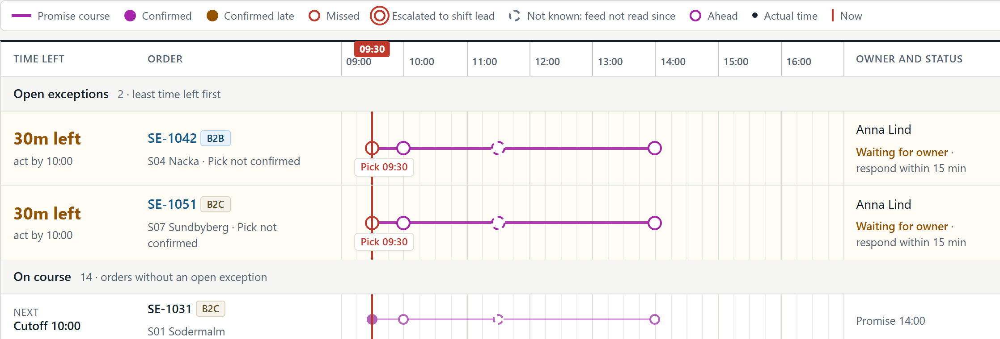

# PromiseOps

Exception management that protects the **original delivery promise**.
Built by team **NgaChainAILayer2** for the IT Consultant Challenge 2026, Round 2 (build-a-thon), from our Round 1 proposal.

PromiseOps tells a distribution-centre coordinator which orders are about to miss their promise, how long is left to intervene, who owns each case, and how it ended.
Existing order and warehouse systems keep owning orders, stock and dispatch; PromiseOps only reads from them.

> All company, people and order data in this repository is fictional.
> No Company A data is used.



## Contents

- [What the MVP does](#what-the-mvp-does)
- [Quick start](#quick-start)
- [Demo walkthrough](#demo-walkthrough)
- [Project structure](#project-structure)
- [Architecture](#architecture)
- [Technical decisions](#technical-decisions)
- [Tests](#tests)
- [Scripts and documents](#scripts-and-documents)
- [JSON API](#json-api)
- [Not in the MVP](#not-in-the-mvp)

## What the MVP does

Every order is drawn as a **course of four controls** on one shared timetable: pick due, dispatch cutoff, last viable dispatch, and the promise.
A red line marks now.
When the line passes a control that has not been confirmed, an exception opens with one owner.

| Round 1 scope | Where to see it |
|---|---|
| Read order and fulfilment events from existing systems | Source adapter, Data health page, `POST /api/events` |
| Two exception types: pick not confirmed, dispatch not confirmed | Rules engine, Exception queue |
| Priority queue, ownership, response timer, escalation | Exception queue, exception detail |
| Actions, reasons and outcomes logged | Activity log on every exception |
| Outcomes against the original promise, B2B and B2C apart | Outcomes page |
| Data freshness guard | Source feeds in the rail, stale banner, data-quality tasks |

Rules taken straight from the proposal:

- Priority is time left to the intervention deadline; ties go to B2B.
- One owner per exception and 15 minutes to respond, then automatic escalation to the shift lead.
- One exception per order and cause; a pick alert suppresses a dispatch alert for the same root cause.
- Only the shift lead can record an expedite.
- Every outcome needs written evidence.
- The original promise can never be edited, so outcomes stay honest.
- A missing event only counts if the source was actually read after the milestone.
- When the fulfilment feed is older than 30 minutes, alerts pause and a data-quality task opens.
- Nothing is written back to source systems.

The interface is available in **English and Vietnamese**.
System sentences (alert reasons, audit notes, errors) are translated too; text typed by people is never translated.

The landing page at `/` presents the product and plays a recorded, annotated walkthrough in the reader's language.

## Quick start

Requires Python 3.11 or newer.

```powershell
.\run.ps1
```

or, step by step:

```powershell
python -m pip install -r requirements.txt
python -m uvicorn --app-dir src promiseops.web.app:app --port 8000
```

Open http://127.0.0.1:8000 for the landing page, or http://127.0.0.1:8000/app for the tool.
The database is created and seeded on first start in `var/promiseops.db`.
Set `PROMISEOPS_DB` to use another file.

## Demo walkthrough

The yellow bar at the bottom of the tool is a **demo harness only**: it replaces real feeds and wall-clock time.
The same steps are recorded with notes in `src/promiseops/web/static/landing/demo-en.webm` and `demo-vi.webm`.

1. Open `/app`. At 09:00 every order is on course and the red line is at 09:00.
2. Click **+30 min**. SE-1042 and SE-1051 missed their 09:30 pick: 30 minutes left before the 10:00 route.
3. Open **SE-1051**, **Take ownership**, record **Verified on floor - alert was wrong** with evidence.
4. Open **SE-1042**, **Take ownership**. Expedite is locked for a coordinator, so **Escalate** with the reason.
5. Switch the role in the rail to **Shift lead** and record **Expedited by shift lead** with evidence.
6. Click **Simulate feed outage**, then **+30 min** and **+15 min**: the feed turns red, alerts pause, a data task opens, no false alarms.
7. Click **Resume fulfilment feed** and **+5 min**: the backlog arrives first, then the rules run on fresh data.
8. Go to **Orders** and click **+5 h**: SE-1042 is delivered before its 14:00 promise; SE-1077 had no vehicle and is late.
9. Open **Outcomes**: on-time rate against the original promise, flagged orders still on time, time to ownership, false alarms.

Without step 5, SE-1042 is delivered late, which is the value the product is meant to prove.
Click **Reset scenario** to start again.

## Project structure

```
promiseops/
├── src/promiseops/
│   ├── config.py              market configuration, roles, outcomes
│   ├── timeutil.py            UTC storage, local display
│   ├── core/
│   │   ├── engine.py          exception rules, freshness guard, escalation
│   │   ├── workflow.py        take ownership, escalate, resolve; role checks; audit
│   │   ├── kpi.py             outcomes against the original promise
│   │   └── timetable.py       course geometry: four controls on one time axis
│   ├── integration/
│   │   ├── ingest.py          source adapter: validation, idempotency, freshness
│   │   └── simulation.py      demo clock and scripted feeds (MVP only)
│   ├── storage/
│   │   ├── db.py              SQLite schema
│   │   └── seed.py            fictional demo scenario
│   └── web/
│       ├── app.py             FastAPI pages, actions, demo controls, JSON API
│       ├── i18n.py            English / Vietnamese
│       ├── templates/         Jinja2 pages and the shared course macro
│       └── static/            app.css, landing page assets and walkthrough videos
├── tests/
│   ├── unit/                  rules, escalation, idempotency, stale data, KPI
│   ├── web/                   pages, HTTP actions, role checks, API, translations
│   └── e2e/                   the core journey in a real browser
├── scripts/                   demo recording, document builders, AI journal filler
├── docs/
│   ├── architecture/          C4 models (.mmd) and diagram previews
│   ├── journey/               journey screenshots and page previews
│   └── video/                 recording script and English subtitles
├── PRODUCT.md                 product truth used for design work
├── pyproject.toml
├── requirements.txt
├── requirements-dev.txt
└── run.ps1
```

## Architecture

One application service with clear modules and one relational database, as proposed for the pilot; no microservices.

```
OMS / WMS (or demo harness) ──► Source adapter ──► SQLite ◄── Rules engine
                                                     ▲              │
Coordinator / shift lead ──► Pages and JSON API ──► Workflow        │ runs after every poll
                                   │                                │
                                   └──► Timetable, Outcomes, i18n ◄─┘
```

One cycle every 5 minutes:

1. The adapter reads each live feed and records that the read succeeded.
2. Duplicates are ignored, bad records rejected and logged.
3. If the warehouse feed is stale, or was not read after a milestone, absence-based alerts pause.
4. Otherwise the two rules create one exception per order and cause, owned by the coordinator, with a 15-minute timer.
5. A person acts; an expedite needs the shift lead; every outcome needs evidence.
6. Every change lands in the audit log.
7. Outcomes are measured against the original promise.

The two-page system diagram (C4 context, then containers and components) is built by `scripts/build_system_diagram.py`.

## Technical decisions

| Decision | Choice | Why |
|---|---|---|
| Backend | FastAPI, one process | Matches the proposal: one service with clear modules |
| Database | SQLite | Relational, zero setup for judges; PostgreSQL is the production step |
| Frontend | Server-rendered Jinja2, CSS, a little vanilla JS | No build step, every page testable over HTTP; the timetable is plain HTML and CSS |
| AI in the product | None | Round 1 argued for explainable rules first; AI was used to build, not inside the product |
| Integration | Read-only adapter, idempotent on source + event id | Never risk the systems of record; re-sent data creates no new work |
| Time | Stored in UTC, shown in Europe/Stockholm | Correct across daylight-saving changes |
| Visual direction | Timetable layout with an orienteering course overlay | Chosen by the team from rolled design directions; see `PRODUCT.md` and `.impeccable/surfaces/` |

## Tests

```powershell
python -m pip install -r requirements-dev.txt
python -m playwright install chromium
python -m pytest
```

- `tests/unit` - rules, escalation, auto-clear, one exception per cause, immutable promise, idempotent ingestion, stale-feed guard, KPI.
- `tests/web` - every page renders, HTTP actions and role checks, API validation, open-redirect guard, Vietnamese rendering, and a check that every template string has a Vietnamese translation.
- `tests/e2e` - the SE-1042 journey in a real browser, with no console errors allowed.

## Scripts and documents

Run against a running app on a separate port and database so nobody's session is disturbed:

```powershell
$env:PROMISEOPS_DB = "$env:TEMP\demo.db"
python -m uvicorn --app-dir src promiseops.web.app:app --port 8766
```

| Script | Produces |
|---|---|
| `scripts/record_demo.py <en or vi> [base-url]` | Annotated walkthrough videos and posters for the landing page |
| `scripts/capture_journey.py [base-url]` | Journey screenshots in `docs/journey/shots/` |
| `scripts/build_user_journey.py [out.pdf]` | Two-page User Journey PDF |
| `scripts/build_system_diagram.py [out.pdf]` | Two-page System Diagram PDF |
| `scripts/fill_ai_journal.py <unpacked-template> <out.docx>` | The challenge's AI Journal, filled |

`docs/video/video-script.md` is the scene-by-scene script for the submitted MVP video; `docs/video/MVP.srt` holds the same narration as English subtitles.

## JSON API

| Method | Path | Purpose |
|---|---|---|
| POST | `/api/events` | Receive a fulfilment event; idempotent on `source` + `event_id` |
| POST | `/api/orders` | Receive an order with its promise and milestones |
| GET | `/api/exceptions` | Open exceptions in priority order |
| GET | `/api/health` | Clock and source freshness |

## Not in the MVP

Route optimisation, automatic replenishment, automatic promise changes, write-back to core systems, multi-country rollout, customer messaging, and a delay-prediction model are out of scope by design.
"Handed to customer service" is recorded as an outcome, not sent.
An AI summary of case notes remains an optional experiment after the pilot, as proposed in Round 1.

## Team and AI use

Team NgaChainAILayer2.
The MVP was built with Claude Code as a pair engineer; the team made the binding decisions (scope, stack, no AI in the product, visual direction, Vietnamese).
How AI was used, what was rejected and why, is recorded in the AI Journal submitted with Round 2.
