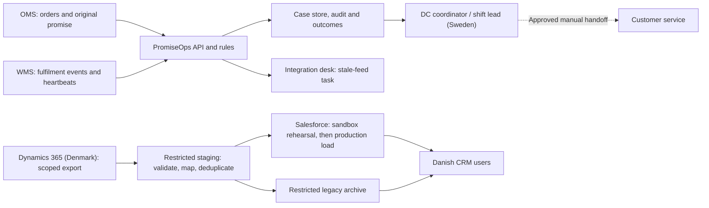

# PromiseOps continuity-first proposal (Round 3)

## Decision for the steering group

Within EUR 126k (30% below the EUR 180k we asked for in Round 1) and the same 12 weeks:

1. **Protect business continuity first.** Migrate the Danish CRM from Microsoft Dynamics 365 to Salesforce before Dynamics is switched off. The cutover window and shared integration staff go to CRM first.
2. **Keep the original objective alive at low cost.** Run the PromiseOps pilot at one Swedish DC in shadow mode, on the MVP we already built in Round 2. Coordinators work real exceptions; the existing floor process still makes the live decisions.
3. **Keep both Round 1 gates.** Gate 1 (week 2) checks that both workstreams fit the money and the deadline. Gate 2 (week 12) accepts the CRM and decides the PromiseOps live phase.

The original rollout scope (pilot plus the EUR 120k Swedish cohort) no longer fits: the CRM migration is mandatory and the budget is smaller. The two reduced scopes fit under the assumptions below. If Gate 1 shows they do not, CRM wins: PromiseOps drops to a replay of historical data on the existing MVP, and any remaining CRM gap goes to the sponsor.

## Assumptions

The brief gives no Company A figures, so these are ours. Each one is checked at Gate 1 and the plan changes if it fails.

| Assumption | Value | If it is wrong |
| --- | --- | --- |
| Budget baseline | Round 1 total ask: EUR 10k validation + EUR 50k pilot + EUR 120k Swedish cohort = EUR 180k. New ceiling EUR 126k | Rescale the allocation table; the order of priorities stays |
| Day rate | EUR 550 blended onshore/nearshore, as in Round 1 | Same person-days, different euros |
| CRM market | Denmark. Keeps the CRM team apart from the Swedish pilot DC | If it is Sweden, the same people are shared: shadow onboarding moves after the cutover |
| CRM scope | One country: accounts, contacts, open opportunities, active cases. Closed history goes to a restricted read-only archive | Larger scope is paid from contingency first, then from the PromiseOps line |
| Salesforce | A Company A Salesforce org with sandbox access exists. Steady-state licences are the country's operating cost; the project pays only the overlap months | A new org or licences in the project budget need a sponsor decision |
| Decommission date | Dynamics stays readable until at least week 10, confirmed in writing | Earlier: CRM-only fast track, PromiseOps paused |
| Pilot DC | One Swedish DC with OMS and WMS feeds we can read, and named data owners (Round 1 Gate 1) | Replay-only pilot on historical extracts |

## Funding: EUR 180k becomes EUR 126k

One unit equals 1% of the EUR 180k baseline, so 1 unit = EUR 1.8k. These are spending ceilings to be confirmed with Finance, not vendor quotes.

| Allocation | Units | EUR | Included |
| --- | ---: | ---: | --- |
| CRM discovery and target setup | 9 | 16.2k | Inventory, scope, permissions, ownership and mappings |
| CRM extraction and migration | 15 | 27.0k | Transformations, data cleanup, dry runs and reconciliation |
| CRM readiness and cutover | 13 | 23.4k | UAT, training, controlled switch, archive validation and hypercare |
| Commercial and shared services | 10 | 18.0k | Licence overlap, secure staging, security and delivery management |
| PromiseOps shadow pilot | 15 | 27.0k | One DC, two read-only feeds, business validation and scorecard |
| Sponsor-held contingency | 8 | 14.4k | Data cleanup, licensing variance or an extra rehearsal |
| **Total** | **70** | **126.0k** | **30% below the EUR 180k baseline** |

**Why PromiseOps fits in EUR 27k.** Round 1 priced the pilot at 88 person-days (EUR 60k). The Round 2 MVP already delivers the application those days paid for: rules, queue, escalation, evidence, outcomes, pilot mode on the wall clock, the JSON API and heartbeats. What remains is connecting real feeds and running the shadow period.

| Role | Round 1 days | Round 3 days | Why |
| --- | ---: | ---: | --- |
| Business analysis | 12 | 10 | Same DC validation, fewer stakeholders in shadow mode |
| Integration | 28 | 22 | API and adapter exist; connect OMS/WMS, add single sign-on and access control |
| Application | 24 | 0 | Built in Round 2 |
| QA and data | 16 | 8 | Shadow scorecard only; no live difference-in-differences yet |
| Adoption | 8 | 6 | Shadow training for one DC |
| **Total** | **88** | **46** | 46 days x EUR 550 = EUR 25.3k, plus EUR 1.6k infrastructure = EUR 27k |

## Schedule: the same 12 weeks and two gates

Round 1 agreed a 12-week pilot with Gate 1 in week 2, shadow alerts from week 7 and Gate 2 in week 12. We keep that frame and fit the CRM migration into it. CRM is the critical path; PromiseOps runs beside it and never depends on it.

| Weeks | CRM critical path (Denmark) | PromiseOps (one Swedish DC) |
| --- | --- | --- |
| W1-2 | Confirm scope, decommission date, licences, sandbox, staff and cost to complete | Confirm the DC, feed access and data owners (Round 1 validation) |
| **Gate 1** | **Both fit the money and the deadline, or CRM takes the headroom** | |
| W3-6 | Configure target fields and permissions; profile data, approve mappings; first dry run | Connect real feeds to pilot mode; single sign-on; replay validation offline |
| W7-8 | Rehearse full and delta loads; UAT, rollback drill, operator training | Shadow alerts start in week 7, as in Round 1 |
| W9 | Freeze source writes, load final delta, reconcile, switch after sign-off | Shadow keeps running; no onboarding work while shared staff are on the cutover |
| W10-12 | Hypercare, reconcile freeze-period work, hand over archive and support | Shadow continues; evidence pack for Gate 2 |
| **Gate 2** | **Danish country lead accepts CRM and support handover** | **Shadow evidence decides the live phase** |

## What changes from Round 1

| Round 1 promised | Round 3 | Why |
| --- | --- | --- |
| One DC, two rules, owner, 15-minute escalation, outcomes against the original promise | Kept unchanged, on the Round 2 MVP | Core value, already built |
| Live decisions from week 9 on 6 treated vs 6 control stores | Shadow only until week 12 | Budget and shared staff go to the CRM cutover |
| Difference-in-differences impact estimate at week 12 | Moved to a 4-week live phase after Gate 2 | Shadow mode cannot measure prevented late deliveries |
| EUR 120k Swedish cohort and the EUR 354k/year base case | Postponed to a new funding decision after live evidence | Not cancelled; it waits for proof |
| SSO with role and site access | Kept: required before real data | The demo role switch is unsuitable for live data |
| (not in Round 1) | Danish CRM migration to Salesforce | Board's must-have for business continuity |

**How the live phase comes back.** If the CRM closes within its budget, the unspent EUR 14.4k contingency funds a 4-week live phase in weeks 13-16 on the Round 1 design (6 treated vs 6 control stores). That restores the impact measurement inside the original six-month investment window, without new money.

## Revised MVP and user journeys

| Workstream | Retain or add | Defer |
| --- | --- | --- |
| PromiseOps | Pick/dispatch rules, freshness guard, deadline priority, single owner, 15-minute escalation, evidence and expedite cost, original-promise KPI split by B2B/B2C, pilot mode, shadow operation | Live decisions until the live phase, multi-site rollout, predictive scoring, automated summaries, CRM sync, automated warehouse or customer actions |
| CRM | Accounts, contacts, open opportunities and active cases if inventory confirms their use. Record ownership, access controls, current work and a searchable restricted archive for scoped history | Custom automation parity, full history import and nonessential reports. Honour retention and access obligations through the archive |

**DC coordinator (Sweden, shadow).** The OMS supplies the original promise and the WMS supplies fulfilment milestones and heartbeats. At 09:30 a pick confirmation is absent. After a later successful WMS read, the coordinator sees the case, acknowledges it and checks with the warehouse. If it goes unacknowledged for 15 minutes, the shift lead gets it. In shadow mode the lead logs what they would do and why. Live dispatch decisions stay in the existing process. If a customer update is needed, the authorised service team uses its current queue and receives only the approved reference and context. When the delivery event arrives, PromiseOps compares it with the original promise. A stale feed pauses new missing-event alerts and routes a data-quality task to integration support.

**CRM operator (Denmark).** During rehearsal, the country lead tests a representative customer record and active case, including ownership, related contact and what the operator can see. After cutover the operator signs in to Salesforce and continues the case with the same business reference. For older records they request authorised archive access. During the freeze, urgent incoming work goes into a controlled queue and is entered once after go-live.

## Revised system diagram

CRM owns customer relationships. OMS/WMS remain authoritative for orders and fulfilment. PromiseOps shares staffing and funding with the migration. Its runtime depends on OMS/WMS only. Before connecting real feeds, put the pilot behind controlled network access and authenticated named users. The current demo role selector is unsuitable for live data. Use sanitised replay if that gate cannot be met within the pilot allocation.

## Migration and release controls

1. **Inventory and map.** The country owner signs off on required objects, fields, ownership, roles and legacy access. Validate option sets, timezone handling, consent and access restrictions. Map Dynamics GUIDs to Salesforce external IDs and use upserts in dependency order. Quarantine duplicates and unlinked records for owner decisions. Limit staging access and expire temporary extracts after acceptance under the agreed retention policy.
2. **Rehearse.** Run a baseline load and replay a delta in sandbox, including merges and deletes if the source supports tracking them. Reconcile counts by object and status from source through exclusions, target and archive. Check relationships, ownership, restricted fields and critical workflows. Require zero unexplained in-scope gaps, zero orphaned critical records, all critical UAT scenarios passing and written approval by business and security leads. Set and rehearse the freeze, recovery and support windows before committing to the cutover.
3. **Switch.** Confirm baseline checkpoint, freeze source writes and capture the final delta and urgent work. Reconcile, rerun smoke tests and obtain go/no-go from the country lead and migration owner before allowing Salesforce writes. If a gate fails before release, keep Salesforce closed and reopen Dynamics within the verified overlap window. After release, capture Salesforce changes and reconcile them before any failback. If Dynamics access is already gone, use the rehearsed controlled work queue and recover forward from the verified snapshot. Never assume source rollback after decommission.
4. **Operate.** Name support owners and review access, backlog and migration issues daily during hypercare. Close once critical issues are resolved, all freeze-period work is accounted for and the country lead accepts archive access and support handover.

## Trade-offs and pilot decision

If money runs short, we give things up in this order: contingency, then optional CRM scope (reports, full history), then the PromiseOps shadow pilot drops to a historical replay on the existing MVP, then a sponsor decision. CRM continuity is never the item we cut.

| Risk or cost | Mitigation and decision owner |
| --- | --- |
| CRM data, custom workflows or licence costs exceed the envelope | Migration lead inventories early, trims optional scope and takes gaps to the sponsor before committing |
| Dynamics is switched off earlier than week 10 | CRM owner secures written overlap at Gate 1, or approves a tested extract-and-recover-forward path; PromiseOps pauses |
| Hard source shutdown eliminates rollback | CRM owner secures written overlap or approves a tested extract-and-recover-forward path before cutover |
| Shared integration or business staff are unavailable | Delivery lead protects CRM milestones and delays shadow onboarding |
| One DC gives limited evidence and shadow mode cannot establish operational savings | Pilot owner reports denominators, baseline and confidence limits where feasible. Keep avoided lateness and savings unclaimed until the live phase |
| The EUR 354k/year base case starts later | Sponsor accepts the delay in exchange for CRM continuity; the live phase restores the evidence without new money if contingency is unspent |
| Manual handoff adds effort and legacy archive adds retrieval time | DC and CRM leads measure handoff effort and test common archive lookups during UAT |

Agree numeric pilot thresholds with the DC owner before observation. Compare feed coverage, proportion of alerts operators judge actionable, median response and share within 15 minutes, on-time delivery by segment, and logged intervention cost. Record how many eligible orders and alerts each measure covers. Use a matched historical period where available and disclose volume or mix differences. Approve the live phase only after CRM handover, pilot data and access gates, and an explicit funding decision.

[15-minute pitch and judge Q&A](pitch.md)
