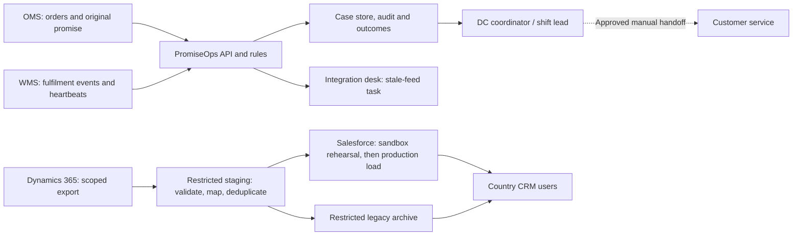

# PromiseOps continuity-first proposal

## Decision for the steering group

Fund a one-market CRM cutover and retain a one-DC PromiseOps shadow pilot. Reserve the cutover window and shared staff for CRM first. Use the existing PromiseOps rules and screens to test whether coordinators can act in time on credible pick and dispatch exceptions. Revisit live rollout after CRM stabilizes and the pilot produces evidence.

The original rollout scope is infeasible within this planning envelope. The two reduced scopes are conditionally feasible. At the discovery gate, check the written decommission date, commercial costs, sandbox readiness, data inventory and named staff capacity against the actual budget and unchanged project end date. If both cannot fit, defer PromiseOps operational onboarding and retain the existing demo. Escalate any remaining CRM shortfall to the sponsor for a funding decision or a source access extension.

## Funding and schedule

These are planning assumptions for a reduced-budget scenario. One unit equals 1% of the original approved all-in budget. Confirm the monetary baseline, committed spend, taxes, currency and treatment of recurring fees with Finance. The table allocates capacity and sets spending ceilings. It does not estimate vendor prices or certify affordability.

| Allocation | Units | Included |
| --- | ---: | --- |
| CRM discovery and target setup | 9 | Inventory, scope, permissions, ownership and mappings |
| CRM extraction and migration | 15 | Transformations, data cleanup, dry runs and reconciliation |
| CRM readiness and cutover | 13 | UAT, training, controlled switch, archive validation and hypercare |
| Commercial and shared services | 10 | Licenses and overlap, secure staging, security and delivery management |
| PromiseOps shadow pilot | 15 | One DC, two read-only feeds, business validation and scorecard |
| Sponsor-held contingency | 8 | Data cleanup, licensing variance or an extra rehearsal |
| **Total** | **70** | **30% below the normalized baseline of 100** |

Assume an illustrative eight-week window with two protected weeks after CRM cutover. Work backward from the real end date and decommission deadline. Assume one CRM market, an existing Salesforce tenant with sandbox access, supported source exports, accessible OMS/WMS feeds for the pilot DC, and named business owners. CRM and the DC pilot can serve different markets. These assumptions bound setup costs and avoid making either system depend on the other.

| Window | CRM critical path | PromiseOps parallel work |
| --- | --- | --- |
| W1 | Confirm scope, access, deadlines, licenses, staffing and cost to complete | Confirm a DC and data owners with approved feeds |
| W2–3 | Configure target fields and permissions. Profile data and approve mappings | Reuse existing API and rules. Validate timestamps and freshness offline |
| W4–5 | Rehearse full and delta loads. Run UAT, rollback drill and operator training | Start shadow queue if feed and privacy gates pass |
| W6 | Freeze source writes, load final delta, reconcile and switch after sign-off | Pause onboarding during shared-staff cutover |
| W7–8 | Hypercare, reconcile missed work, and hand over archive and support | Review evidence and decide whether to fund live pilot |

## Revised MVP and user journey

| Workstream | Retain or add | Defer |
| --- | --- | --- |
| PromiseOps | Pick/dispatch rules, freshness guard, deadline priority, single owner, 15-minute escalation, evidence and expedite cost, original-promise KPI split by B2B/B2C | Multi-site rollout, predictive scoring, automated summaries, CRM sync, automated warehouse or customer actions |
| CRM | Accounts, contacts, open opportunities and active cases if inventory confirms their use. Record ownership, access controls, current work and a searchable restricted archive for scoped history | Custom automation parity, full history import and nonessential reports. Honor retention and access obligations through the archive |

**DC coordinator.** The OMS supplies the original promise and the WMS supplies fulfilment milestones and heartbeats. At 09:30 a pick confirmation is absent. After a later successful WMS read, the coordinator sees the case, acknowledges it and checks with the warehouse. If it goes unacknowledged for 15 minutes, the shift lead gets it. In shadow mode the lead logs what they would do and why. Live dispatch decisions stay in the existing process. If a customer update is needed, the authorized service team uses its current queue and receives only the approved reference and context. When the delivery event arrives, PromiseOps compares it with the original promise. A stale feed pauses new missing-event alerts and routes a data-quality task to integration support.

**CRM operator.** During rehearsal, the country lead tests a representative customer record and active case, including ownership, related contact and what the operator can see. After cutover the operator signs in to Salesforce and continues the case with the same business reference. For older records they request authorized archive access. During the freeze, urgent incoming work goes into a controlled queue and is entered once after go-live.

## Revised system diagram

CRM owns customer relationships. OMS/WMS remain authoritative for orders and fulfilment. PromiseOps shares staffing and funding with the migration. Its runtime depends on OMS/WMS only. Before connecting real feeds, put the pilot behind controlled network access and authenticated named users. The current demo role selector is unsuitable for live data. Use sanitized replay if that gate cannot be met within the pilot allocation.

## Migration and release controls

1. **Inventory and map.** The country owner signs off on required objects, fields, ownership, roles and legacy access. Validate option sets, timezone handling, consent and access restrictions. Map Dynamics GUIDs to Salesforce external IDs and use upserts in dependency order. Quarantine duplicates and unlinked records for owner decisions. Limit staging access and expire temporary extracts after acceptance under the agreed retention policy.
2. **Rehearse.** Run a baseline load and replay a delta in sandbox, including merges and deletes if the source supports tracking them. Reconcile counts by object and status from source through exclusions, target and archive. Check relationships, ownership, restricted fields and critical workflows. Require zero unexplained in-scope gaps, zero orphaned critical records, all critical UAT scenarios passing and written approval by business and security leads. Set and rehearse the freeze, recovery and support windows before committing to the cutover.
3. **Switch.** Confirm baseline checkpoint, freeze source writes and capture the final delta and urgent work. Reconcile, rerun smoke tests and obtain go/no-go from the country lead and migration owner before allowing Salesforce writes. If a gate fails before release, keep Salesforce closed and reopen Dynamics within the verified overlap window. After release, capture Salesforce changes and reconcile them before any failback. If Dynamics access is already gone, use the rehearsed controlled work queue and recover forward from the verified snapshot. Never assume source rollback after decommission.
4. **Operate.** Name support owners and review access, backlog and migration issues daily during hypercare. Close once critical issues are resolved, all freeze-period work is accounted for and the country lead accepts archive access and support handover.

## Trade-offs and pilot decision

| Risk or cost | Mitigation and decision owner |
| --- | --- |
| CRM data, custom workflows or license costs exceed the envelope | Migration lead inventories early, trims optional scope and takes gaps to the sponsor before committing |
| Hard source shutdown eliminates rollback | CRM owner secures written overlap or approves a tested extract-and-recover-forward path before cutover |
| Shared integration or business staff are unavailable | Delivery lead protects CRM milestones and delays shadow onboarding |
| One DC gives limited evidence and shadow mode cannot establish operational savings | Pilot owner reports denominators, baseline and confidence limits where feasible. Keep avoided lateness and savings unclaimed until validated |
| Manual handoff adds effort and legacy archive adds retrieval time | DC and CRM leads measure handoff effort and test common archive lookups during UAT |

Agree numeric pilot thresholds with the DC owner before observation. Compare feed coverage, proportion of alerts operators judge actionable, median response and share within 15 minutes, on-time delivery by segment, and logged intervention cost. Record how many eligible orders and alerts each measure covers. Use a matched historical period where available and disclose volume or mix differences. Approve a live trial only after CRM handover, pilot data and access gates, and an explicit funding decision.

[15-minute pitch and judge Q&A](pitch.md)
